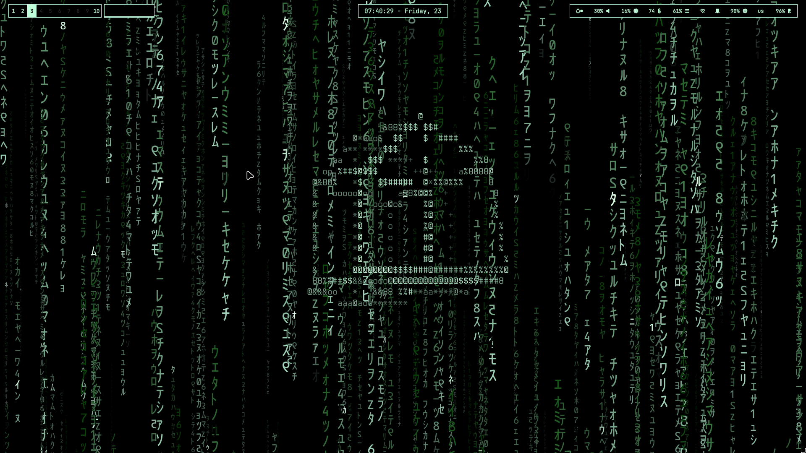

# cornice

A minimal Wayland desktop, in two binaries:

- **`cornice`** — a wallpaper platform. Claims one monitor with `wlr-layer-shell`,
  opens a background surface, and renders a pluggable `FrameSource` into it. The
  bundled source is a rotating 4D ASCII tesseract behind a field of matrix rain.
- **`cornice-bar`** — a status bar on `wlr-layer-shell`, written for Hyprland:
  workspaces, a cava audio visualiser, the system tray, and a waybar-style widget
  strip (volume, CPU, temperature, memory, network, brightness, keyboard layout,
  battery).

Both are single static-ish Rust binaries with no runtime dependency on a config
daemon. Every option lives in a commented TOML file that is generated on first
run and hot-reloaded on edit.

```console
$ cornice        # wallpaper
$ cornice-bar    # status bar
```

## Screenshot

<!-- Add docs/screenshot.png (a full-screen shot with both programs running) and
     uncomment the line below. -->
<!--  -->

## Requirements

- A Wayland compositor implementing `wlr-layer-shell`. Developed against
  **Hyprland**; the wallpaper only needs the layer-shell protocol, the bar
  additionally reads Hyprland state over `hyprctl`.
- Rust **1.88+**.
- `libxkbcommon` and the usual Wayland client libraries at build time.
- A monospace font. The bar prefers a Nerd Font for its icons; see
  [Fonts](#fonts).

Optional, for the bar's richer modules — each degrades gracefully when missing:

| Tool | Used for |
| --- | --- |
| `cava` | the audio visualiser (spawned as a subprocess) |
| `wpctl` | volume read/scroll (`pipewire`/`wireplumber`) |
| `swaync-client` | notification bell and Do-Not-Disturb toggle |
| `brightnessctl` | brightness scroll |
| `hyprctl` | workspaces and keyboard layout |

## Build

```console
$ git clone https://github.com/aasb13/cornice
$ cd cornice
$ cargo build --release
```

The binaries land in `target/release/`. To install:

```console
$ install -Dm755 target/release/cornice     ~/.local/bin/cornice
$ install -Dm755 target/release/cornice-bar ~/.local/bin/cornice-bar
```

## Running

Both programs pick the **leftmost** output by default, deterministically, so the
bar and the wallpaper land on the same screen. Override with `--monitor`:

```console
$ cornice --monitor DP-1
$ cornice-bar --monitor DP-1 --height 32
```

The bar reserves an exclusive zone, so tiled windows start below it.

### Hyprland

Add both to your startup, after Hyprland's own sockets exist:

```ini
# ~/.config/hypr/hyprland.conf
exec-once = cornice
exec-once = cornice-bar
```

## Configuration

Each binary owns one file, created on first run as a fully commented template
containing every option at its default:

- `~/.config/cornice/config.toml`
- `~/.config/cornice-bar/config.toml`

Point `--config PATH` at something else to use a different file. Print what is
in effect, or the template itself, without drawing:

```console
$ cornice --print-config
$ cornice --print-default-config
```

**Unknown keys are an error, not a silent no-op.** A typo stops the binary at
startup with the offending name, rather than leaving you with a blank wallpaper
and no clue which line caused it.

### Live reload

Edits apply without a restart. The file is polled every `interval_ms` (default
500 ms) and re-parsed only when its mtime or size actually changed:

```toml
[reload]
watch = true
interval_ms = 500
```

To force a reload regardless of `watch`, or when the file is on a filesystem
where mtime is unreliable:

```console
$ cornice --reload
$ cornice-bar --reload
```

`--reload` sends `SIGHUP` to the other process running the same binary — it
matches on the executable, so it will not signal an unrelated process.

A **broken config never takes the running process down.** A parse error at
startup is fatal (there is no previous config to fall back to); a parse error
during a reload is logged and the last good config stays in effect. That is
deliberate: a typo mid-edit should not blank your screen.

### Wallpaper options

```toml
source  = "cube3d"   # the only bundled source
fps_cap = 0          # 0 = no cap, i.e. the display's refresh rate

[power_save]         # dial back while running unplugged
enabled      = true
fps_cap      = 30
rain_divisor = 4
```

`[cube3d]` tunes the tesseract and the rain — glyph ramp, colours, rotation
speeds, rain density, wall speed/length/depth ranges. Run
`cornice --print-default-config` for the annotated list.

Power saving reads `/sys/class/power_supply`: it throttles only when a battery
exists **and** is discharging, so a desktop never throttles and a plugged-in
laptop runs at full speed.

### Bar options

```toml
[colors]             # the whole palette
accent           = "#bfffd9"
background       = "#000000"
background_hover = "#1a1a1a"
on_accent        = "#000000"
inactive         = "#222222"

[cava]
mode = "graph"       # "graph" (oscilloscope trace) or "bars"
```

### Adding a wallpaper source

`cornice` knows nothing about what it renders. A source is a struct
implementing `FrameSource` in `cornice/src/source.rs`:

```rust
pub trait FrameSource {
    fn init(&mut self, width: u32, height: u32);
    fn render(&mut self, canvas: &mut [u8], width: u32, height: u32, stride: u32) -> bool;
    fn tick_interval(&self) -> Option<Duration>;      // None = static
    fn set_power_saving(&mut self, state: PowerState);
    fn reconfigure(&mut self, config: &Config, width: u32, height: u32);
}
```

Return `false` from `render` to skip the commit for that tick. Register it in
`cornice/src/main.rs` and add its name to `SOURCES` in `cornice/src/config/mod.rs`.

## Fonts

The bar draws every glyph with a single font, loaded once from the first path
that exists in its search list. The Nerd Font variants are tried first because
they are supersets: the widget icons, the visualiser's block elements and any
characters a tray menu uses all come from the same file.

If no font is found, the bar logs an error and draws nothing. The wallpaper has
its own search list; both can be overridden per-source in the config
(`font_path`, `waterfall_font_path`).

## How it fits together

```
cornice/          wallpaper binary: Wayland plumbing, power monitor, FrameSource
  sources/        the cube3d source (tesseract + rain)
cornice-bar/      status bar binary: modules, tray, menu popups, Hyprland events
cornice-config/   shared config loading, template generation, live reload, SIGHUP
```

The workspace resolves to three crates. `cornice-config` is the only shared one:
it owns finding, creating, watching and re-reading the TOML file, plus the
`--reload` signal plumbing, so neither binary has to re-implement — or
re-implement differently — the "a bad edit must not kill the process" rule.

Threading follows one rule: **long-lived blocking work never runs on the event
loop.** The power poller, the cava reader, the tray client and the Hyprland event
listener each own a thread and publish into a `calloop` channel; the event loop
only paints. `SIGHUP` is blocked process-wide before any thread starts, because
a signal mask is per-thread and `signalfd` only receives a signal that every
thread has blocked.

The widget strip is the deliberate exception: it re-samples CPU, memory,
temperature, network and the external tools once per second, in `draw`. Those
reads are a few file reads plus a `hyprctl`/`wpctl`/`swaync-client` fork each
second — short enough to keep on the loop, and keeping them there means a click
on the volume segment can scroll and immediately re-read the new value without
racing a detached process.

## Development

```console
$ cargo test --workspace
$ cargo clippy --workspace --all-targets
$ cargo fmt --all --check
```

The test suite covers the parts that are cheap to get wrong and expensive to
notice: config template round-trips, unknown-key rejection, colour byte order
(BGRA in memory, RGB in the file), the reload watcher's change detection, the
`--reload` sibling signal, and pixel-level checks that each bar module draws
inside its box.

## License

MIT.
